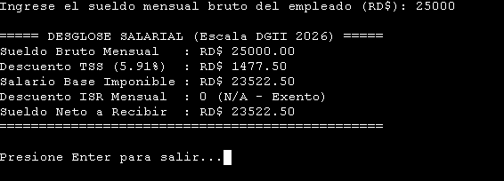
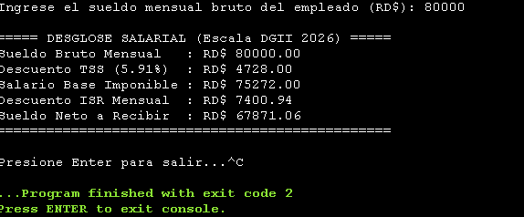
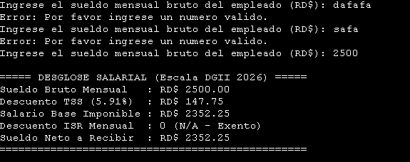

# Actividad 2: Cálculo del Impuesto Sobre la Renta (ISR)

## Datos del Estudiante
- **Nombre:** Chris Joseph Jean Carty
- **Matrícula:** 2025-1965

## Resumen del Proyecto
Este programa fue desarrollado en C++ para calcular el descuento mensual del ISR de un empleado en la República Dominicana, aplicando estrictamente la escala salarial oficial establecida por la DGII para el año 2026. 

Para lograr un cálculo fiscal realista y apegado a la norma laboral local, el algoritmo ejecuta los siguientes pasos:
1. Recibe y valida el **Sueldo Bruto Mensual** asegurándose de que sea numérico y mayor a 0.
2. Calcula y descuenta de inmediato el **5.91%** correspondiente a los aportes de Seguridad Social (TSS) para aislar el *Salario Neto Imponible*.
3. Proyecta este salario a una escala anual y lo procesa a través de la escala progresiva de retención de la DGII 2026 (Exento hasta RD$ 416,220.00; y tramos del 15%, 20% y 25% para los excedentes).
4. Si el empleado se encuentra en el tramo exento, se imprime un `0 (N/A)` tal como se solicita en el requerimiento. Si aplica, se muestra el valor a retener.

## Capturas de Pantalla en Ejecución

### Escenario 1: Sueldo Exento (No aplica descuento ISR)
*(En este ejemplo el salario no supera la franja exenta anual)*

### Escenario 2: Sueldo Gravado (Aplica descuento progresivo)
*(En este ejemplo el salario ingresa a los tramos de retención fiscal)*

### Escenario 3: Validación de Errores (Caracteres Inválidos)
*(Prevención de colapso de consola con validación defensiva en bucle)*
